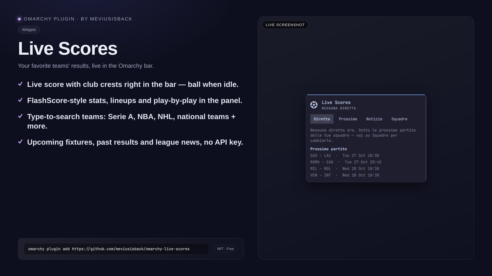

<div align="center">

# Live Scores

**Live scores of your favorite teams in the Omarchy bar — logos, score and minute at a glance, FlashScore-style stats, fixtures and news in the panel.**

[](LICENSE)





</div>

## Why

Following your teams shouldn't mean keeping a browser tab open. Live Scores puts the current score in the bar — logos, score and minute at a glance, pulsing when a goal goes in — and the full match story one click away in the panel: stats, timeline, lineups, commentary, upcoming fixtures, results and news. When none of your favorites are playing, it quietly shows a ball `` and the panel becomes settings.

## Features

- **In the bar** — while a favorite is playing: team logos, score and minute (e.g. `INT 2–1 FIO 67'`). The score **pulses** when a goal is scored; otherwise just a ball.
- **Live tab** — score with logos, FlashScore-style stats (possession, shots, corners, fouls, saves, cards), goal/card timeline, **lineups** (11 starters per side) and textual play-by-play **commentary** in English, as provided by ESPN.
- **Upcoming tab** — only your favorites' matches (3 days ahead), plus a **Results** section with finished matches.
- **News tab** — news from your teams' leagues; click to open.
- **Teams tab** — **search as you type** (2+ letters) across every configured league, with logo: press ＋ to follow, ✕ to remove, then Save. National teams included (search "italia"); free words (e.g. `como`) and ESPN ids work too.
- **Open on FlashScore** and **Gamecast ESPN** buttons for full details.

## Install

```bash
omarchy plugin add https://github.com/meviusisback/omarchy-live-scores
omarchy bar put meviusisback.live-scores --section left
```

Or clone by hand into `~/.config/omarchy/plugins/meviusisback.live-scores` and rescan:

```bash
omarchy-shell shell rescanPlugins
```

## Usage

- Click the bar icon to open the panel: keys `1–4` switch tabs, `R` refreshes.
- Right-click the icon to refresh immediately.
- To follow a team: open the **Teams** tab, type 2+ letters, press ＋ on the team, then **Save**.

## Requirements

- Omarchy with the Quickshell shell
- `python3` (standard library only, nothing to install)
- Internet access (ESPN API + team logos)

## Configuration

Settings live in the panel, equivalently in `shell.json`:

| Key | Example |
|---|---|
| `favoriteTeams` | `inter,milan,juventus,napoli,roma` (or ESPN ids: `103,118`) |
| `leagues` | `soccer/ita.1,soccer/eng.1,…,basketball/nba,basketball/euroleague,basketball/lba,hockey/nhl` |
| `refreshIntervalSec` | `90` (30–600) |

Search covers every team in the leagues above: all of Serie A, 30 NBA, 32 NHL, EuroLeague, national teams and more.

## How it works

A stdlib-only fetcher (`fetch_scores.py`) polls the ESPN public API (`site.api.espn.com`, **no key needed**) covering soccer (Serie A, Premier League, LaLiga, Bundesliga, Ligue 1, Eredivisie, Liga Portugal, Champions League, Europa League, Euros, Nations League with national teams), basketball (NBA, EuroLeague, Italian LBA Serie A) and hockey (NHL) — but not the lower divisions, which is the gap vs the full FlashScore database. European basketball beyond EuroLeague (EuroCup, domestic leagues) and the World Cup outside tournament time are not exposed by ESPN. The "FlashScore-style stats" are the official match data presented the FlashScore way; the panel button takes you to the real FlashScore page. `Panel.qml` renders bar and panel from the fetched JSON.

Verify with `PYTHONPATH=. python3 tests/test_backend.py` — 22 tests, fixtures only, no network. Probe the fetcher directly:

```bash
python3 fetch_scores.py --favorites "inter,milan" --leagues "soccer/ita.1" | head -c 600
python3 fetch_scores.py --teams | head -c 300
```

## Removal

```bash
omarchy bar remove meviusisback.live-scores
omarchy plugin remove meviusisback.live-scores --yes
```

## License

MIT — see [LICENSE](LICENSE).
